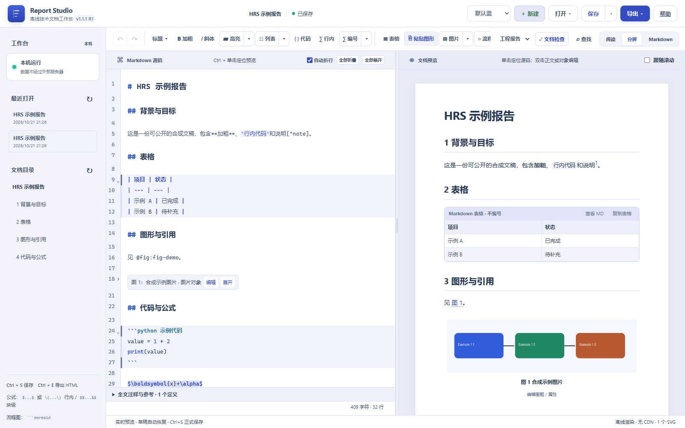
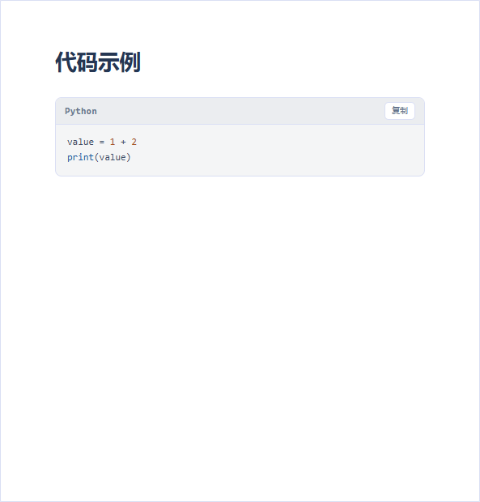
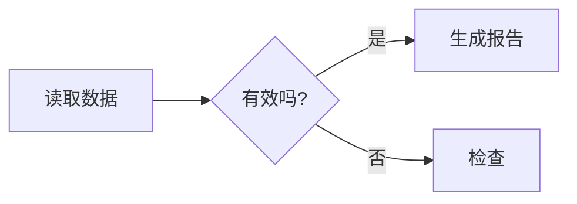

# HTML Report Studio 使用手册

**适用版本：以本包 release.json 为准；历次差异见更新记录。**

左侧写 Markdown，右侧看排版；插入图表、公式和流程图，保存为工程并导出可以直接分享的 HTML。本文按实际操作查阅，历次版本变化见[更新记录](CHANGELOG_READABLE.md)。

## 先看这一页：五分钟完成第一份报告

1. 解压 **Windows 完整便携版**到一个自己有权限的文件夹。桌面版双击 `HRS.exe`；浏览器版双击 `启动编辑器.vbs`。
2. 点 **「＋ 新建」**，选择适合的报告模板，然后在左侧写标题和正文，右侧会同步预览。
3. 用工具栏 **「▧ 图片」** 加图片，或用 **「▦ 表格」** 做数据表格。图题、表题不用自己写“图 1、表 1”。
4. 正文需要引用图表时，点 **「↗ 引用」**，从列表中选择要引用的对象。章节用引用右侧 **「▾ → 章节引用」**。
5. 按 **Ctrl+S** 或点顶部 **「保存」**。第一次正式保存时先填**项目文件夹名称**，再选择它的**父目录**。
6. 点 **「导出 ▾ → 导出 HTML」**，选择画质和是否保留可回编源稿。正式项目的成品放在项目的 `output/` 文件夹里。

**小提醒：** 页面写着“草稿已备份”不等于正式保存。重要内容写完后，请记得 Ctrl+S。

查找框、文件名等原生输入框获得焦点时，Ctrl+Z／Ctrl+Y处理该输入框的编辑；回到源码区后继续撤销文稿。表格编辑窗口中的撤销仍属于本次表格会话，取消不改原稿，应用后整张表作为一笔文稿修改。

软件运行在本机。桌面版自带渲染内核；浏览器版优先使用Chrome，找不到时回退Edge。普通便携版无需另外安装Python、Node或Office，自带基础Word组件，原生公式按需配置转换器。

## Windows桌面运行

桌面版与浏览器版使用同一编辑器和文稿格式。窗口右上角关闭、文件菜单退出和程序内退出都会先确认恢复草稿；操作尚未完成或草稿写入失败时，窗口保持打开。草稿备份仍不等于正式保存，正式保存继续使用Ctrl+S。

桌面文件菜单可直接导出PDF或调用系统打印，视图菜单可放大/缩小/恢复实际大小。外部链接交给系统浏览器，编辑窗口保持；Word仍使用上文同一导出入口和模板。桌面不要求安装Chrome/Edge，浏览器版继续保持原运行方式。

桌面默认草稿、设置和工程索引在 `%LOCALAPPDATA%/HTMLReportStudioDesktop`；工程文件仍在自己选择的项目目录。文件菜单“离线更新…”先显示目标版本和摘要，确认后安全退出、更新并重启；可“回退上一次核心更新…”。若更新后无法启动，可退出其他相关窗口后运行包内“回退核心.cmd”。只用适用于当前桌面基础版本的核心更新包，不要将三合一覆盖包直接覆盖到桌面目录。强制结束程序可能留下运行记录，下次启动会核对原实例并接续恢复；未送达的最后输入不能保证保留。


## 章节、图表与公式编号

模式选择旁的编号设置包括“章节编号”“图表编号”“公式编号”。自由笔记可分别开关；新自由稿均默认关闭。工程报告固定章节及图表编号，公式仍可选，默认关闭。一级题名不编号，二级标题开始显示1、1.1等章号。普通Markdown表与增强表共用表号，普通Mermaid与图片/组图共用图号，所有块公式共用公式号。切换设置不修改Markdown，随工程、草稿及可回编HTML保存。Word按工程章节/图表规则输出，公式服从本次勾选。

标题里自己输入的 `1.1`、`2` 是普通文字，程序不会猜测或删掉。若开启程序编号，这些文字也会保留；新稿需要自动编号时直接写不带号的标题即可。工程检查会提醒数字开头的标题供核对，仍按已有导出确认规则处理。

章节引用 `@sec:sec-purpose` 在分屏和阅读均可单击定位；代码示例保持原文。切换文稿会清除旧检查面板、状态与短提示。左上角完整版本及悬浮提示与服务端 `/api/health` 一致。

## 导出 Word（beta）

工程报告模式从“导出 ▾ → 导出 Word beta”直接打开配置窗口。只有一个一级标题（或没有一级标题）的自由稿先就地切换工程模式并检查，不生成临时稿；核对后再点Word导出。多一级标题台账仍选择整篇或专题进入临时工程页，独立检查/编辑后编译。需要副本或管理已有临时稿时，可选“独立工程预览…”。小矩形 beta 位于功能名右上方，颜色跟随所选主题。首次导出先建立独立工程；已有工程存在未保存修改时，可选择导出当前工作快照或先正式保存。

1. **选择 Word 母模板。** 默认使用配套母模板 v0.3.11。需要封面、目录和页眉时，先在现有“模板样式工具”中把格式样式应用到工程模板并指定正文起点，再在此选择生成的 .docx。普通带封面文档不能直接作为已经准备好的母模板。
2. **生成 Word。** 文件名自动附加时间和唯一后缀，写入当前工程 output/。同目录的 .docx.hrs-bridge.json 是原 Bridge 来源映射，按需一同保留以便后续回读。程序读取当前文稿和附件快照，不改写 report.md、图片原件或母模板。
3. **打开成品。** 完成窗口可打开 Word 或输出文件夹。目录仍是原生域，在 WPS／Word 中更新目录即可；封面上的字面题名和日期仍按模板本身填写，不自动猜改。

模板选择作为本机该工程的偏好保存，不写入 Markdown。“设为默认模板”会按现有模板契约检查后，将副本保管到软件 data 中的 word-templates/；原模板移动后仍可使用，新工程优先选它。已有工程保留自己的模板偏好。“使用程序原始模板”只让本次选择回到软件自带母模板，不删除自选默认模板。自由笔记请求 Word 时同样执行工程规则：自动编号、代码和摘要依照现行母模板，未支持的复杂 HTML、嵌套脚注或脚注图片等明确提示，不能静默删除后导出。

完整便携版已经包含基础 Word 组件，打开窗口即可使用，不需要三合一 Full、Node、Playwright 或第二个浏览器。它使用 HRS 自带 Python 和当前页面的既有解析／图形能力；模板编译仍由原 Bridge／WPS 核心执行。三合一 Full 内运行也会自动识别配套代码和已有依赖。“更换组件…”只用于重新指定同版组件或 Full，日常不必操作。

HRS 2.0系列便携包固定携带Bridge 0.3.0，独立DocFlow组合使用Bridge 0.4.2；两个号码表示各自的发行组合。更新HRS时优先使用同包组件，兼容性由页面模型与组件清单核对，不以Bridge版本号大小判断。

已有项目图片可使用 `assets/a.png`、`./assets/a.png` 或 `assets/sub/a.png`。预览、检查、保存与HTML恢复遵守相同路径规则。正式保存时，独立一行的Markdown图片按原规则成为可编辑、可编号的图片对象；行内图片和HTML图片保留原展示方式。子目录中的图片不会被素材整理自动删除。路径含空格、中文或特殊编码等不在工程路径规则中的本地原图，仍通过“导入Markdown”按资源导入流程处理，原件保留。

**公式支持按需配置。** 不含公式的报告可直接导出；代码块里的公式写法仍是代码。含公式且尚未配置时，会明确提示。在“公式支持（可选）”中选择已有 pandoc.exe，或将可选公式包解压到程序目录，形成 word_formula/pandoc.exe；重新生成即可。已有 Full 时可选择其中 environment/pandoc/pandoc.exe，不需要复制整套环境。公式输出仍是可编辑原生 OMML，未支持公式明确报错。beta 标记及既有 HTML／PDF 操作保持。

## 选择渲染与输出模式

工具栏“文档检查”左侧可选择“自由笔记”或“工程报告”。自由笔记保留安全HTML等显示能力，适合HTML/PDF阅读；工程报告自动为H2及以下章节编号，H1题名不编号，目录同步。选择只影响显示/输出，源文不添加数字；已保存工程的选择保存在meta.json，新文档随正式保存建立配置。旧工程没有配置时保持自由显示。

工程模式不启用任意HTML排版；不能直接用于工程输出的HTML会显示源码，并可在文档检查中查看提醒。Word由独立Bridge提供，任何模式都按工程模板规则预检；没有转换映射的内容会明确报错，不会悄悄丢弃。正式图、组图、表、公式及引用继续使用原语法。

新建工程报告的摘要提示是 `> 摘要：…`，位于题名之后、第一章之前。没有摘要时删除整块。不要再添加“## 摘要”来表达这一角色；旧文稿中的该标题仍是正常章节，不会自动改写。代码围栏只是代码文字，不会执行。


## 选择配色与辨认导出件

顶部配色框提供默认蓝、青瓷轻雾、暮山黛紫、石墨天青、藏青云母、暖纸赭石。配色影响界面、阅读包和导出HTML，不改变自由／工程模式或正文。工程、草稿和可回编HTML保存配色，恢复后可以继续使用；缺少配置的旧稿默认蓝色。帮助始终保留原蓝色布局。

导出件内保存自由／工程标识，使离开编辑器的阅读器继续按同一规则呈现。界面导出的默认文件名使用“笔记／报告”前缀；程序明确指定的输出路径保持原样。Word继续由Bridge按母模板工程规则输出，不迁移自由HTML布局。

## 继续、整理或独立保存临时稿

Word准备窗口按时间列出临时稿，并显示占用和来源是否已经变化；超过一页点“加载更多”。“查看归档和回收站”可继续归档稿或恢复回收稿。归档/回收保留恢复草稿及附件，不会清理原台账。来源变化只作提示，临时稿不会被自动更新。

从最近打开、独立工程预览窗口或启动恢复进入，均使用已确认的恢复草稿；多个草稿可选择。正式源被外部修改时，保存仍会提示冲突。临时工程页可“保存为独立工程”，用系统选择器指定新的父目录和名称，形成新的report.md/assets；原台账与临时稿仍保留。

准备附件较多的报告时，屏幕显示验证/复制/核对阶段及复制进度，可点取消并等服务完成清理。已交付成功的工程不会因迟到的取消请求被删除。其他窗口可继续备份草稿。

## 操作折叠对象与 HTML 源码

从Word或WPS复制包含正文、图片和普通／合并表格的区域后，在源码编辑区按Ctrl+V：文字保留内容和数字，去掉字体、颜色等Word排版；图片成为正常图片对象，表格成为可编辑的增强表格，按复制顺序插入。图表题注先留空，不猜测附近文字的用途。整段粘贴可以一次撤销／重做；附件先进入当前草稿，正式保存后进入工程assets/。粘贴到普通代码围栏内仍按文字处理。

Windows本机剪贴板还会读取Word实际携带的图片，避免插入整段内容的预览大图或保留失效临时路径。能可靠对应时优先保留RTF中的原图片数据。缺图、格式不支持或粘贴期间源稿／选区变化时，整段不插入并提示原因。嵌套表格、表内普通图片及无法取得完整数学的嵌入对象暂不在此快捷入口内；不自动下载外部图片。此入口用于快速摘录，不替代完整Word结构识别。

左侧折叠卡片单击后选中完整源块；右键可复制源码、剪切或删除，也可用 Ctrl+C、Ctrl+X、Delete／Backspace。剪切和删除进入原撤销记录，可用 Ctrl+Z 撤销。原来的“编辑／展开”按钮继续使用。

复制的是完整对象源码及其引用附件。粘贴时生成新 ID，组图和同一片段内的引用同步映射；片段外引用保持原文，不能找到时由文档检查报告。附件先放目标草稿，未保存的新工程也能预览，首次保存后进入 assets/。同一工程内剪切移动尽量保留原 ID，发生冲突时另分配。撤销、重做和恢复草稿保留附件；删除对象不会立即删除共享资源。完整多行原始 HTML（如 div、details、table）也可折叠；行内 span、sub、sup 保持行内，HTML 围栏继续按代码折叠。

## 图片对象、目录与配色

独立成段的本地Markdown图片在正式保存或“保存为独立工程”时，使用现有图片对象格式保存，每处图片有独立ID，图片说明成为可编辑图题，参与图表编号、目录和引用；资源继续共用assets原件。已有对象不重复转换。正文中的小图、表格内图片、代码/HTML示例保持原位置和语法。普通导入不修改外部原文件。

目录长标题换行显示，条目不纵向压缩，仅目录列表滚动。切换配色时保留最后可用主题，样式加载成功才应用；加载失败或超时恢复原配色并释放控件，正文不变。

## 同步临时稿到源文件

临时工程页默认只保存副本。点“同步回源稿…”，先查看正文、共享脚注/链接定义的差异，再点“确认同步源文件”。同步只提交提取时冻结的范围，保留其他专题，新增附件经原资源校验后进入源工程；原report.md先备份到.history。取消差异窗口不写源稿。

来源正式文件、待处理恢复草稿、临时稿或附件变化时拒绝提交，不猜测合并。范围与共享定义在成功提交后重定位，可继续修改并再次审查同步。提取时来源尚未正式保存，或旧版临时稿缺少可回写的范围快照时，按钮不可用；先保存源稿，再准备新的临时稿。独立另存始终保留原台账和临时稿。此操作不会改变A0/CLI plan/apply的权限。

## 自由笔记高亮

在 Markdown 中选中文字后点“高亮”，或直接写 `==重点==`。右侧箭头可选黄、橙、红、粉、紫、蓝、青、绿八种浅底色，或清除选中文字的高亮；光标在一个高亮片段中也可清除该片段。菜单可随窗口和工具栏滚动定位，点击外部或 Escape 关闭。`==🔴重要==`、`==🟢进展==`、`==🔵信息==` 保留这些文字和符号，并使用相应底色；普通 `==文字==` 默认黄色。工具栏的黄色按钮写成 `==文字==`，其他颜色写成带 background-color 的安全 mark 标签，不依赖额外颜色记录；因此选橙色后看到 `<mark style="background-color:#ffe0b2">文字</mark>` 属于正常的源码表示。相同文本无论导入还是手动输入，都按同一规则显示；双等号内不能首尾留空格，反引号和代码围栏中的写法只是示例。

在分屏预览中，可以选择同一个可编辑正文段落内的文字后高亮；复杂源块请使用 Markdown。阅读视图不改正文排版；点击文字编辑工具时先回到分屏，选择文字后再执行。自由模式含安全HTML的复杂块继续双击编辑源码，避免反序列化丢失标签；工程模式的双等号降为普通文字，简单块仍可原位编辑，源语法保留。代码示例里的双等号仍是代码。工程模式和 Word 去掉彩色装饰、保留文字，不更改自由笔记原稿。

## 台账、专题聚焦与自由留白

聚焦单个专题后，末尾插入表格或图片仍可按 Enter 换行、继续写正文。专题自己的末尾空行保留可编辑，前后专题仍受保护；回到全部专题时仍是同一份源稿。

自由笔记可在同一稿里用多个一级标题 `# 专题名` 组织长期资料。左边目录上方“查看范围”默认是“全部专题”，也可选一个专题。源码、右侧和目录同时聚焦，底层仍是同一份完整源稿。开启相应编号后，本专题章节、图表和公式各自从1开始；返回“全部专题”恢复全文编号。原对象ID不变，跨专题引用注明所属专题并按原ID跳转；脚注仍沿全文号码。源码全文搜索结果也可切换专题。专题边界外的输入受保护；单纯滚动不会频繁换专题。相关脚注定义在源码下方的可展开面板单独查看/编辑，正文中的全局定义隐藏，选择跨过隐藏定义时会提示分段编辑。想看全部定义可切回全部专题。Ctrl单击定义源码直接定位对应脚注。重新打开文稿默认显示全部。

第一个一级标题前的内容显示为“前言／未分组内容”；没有一级标题时整篇作为一个单元。同名标题仍是不同专题，按顺序区分。专题只是查看和提取范围，无需拆散原稿。各专题首行标题以及隐藏脚注后面的标题，沿用同等级源码字号、字重和颜色；源码行号仍对应完整源稿，便于检查与定位。

勾选目录处“保留连续空行”，两个内容块之间留一个空行仍是普通分段；两个空行多留一行高度，三个多留两行。新建自由笔记及普通MD导入默认开启，旧稿保持原显示，可主动打开。代码/列表/引用/表格/HTML内部仍遵循原语法，工程模式和Word保持工程段落规则。预览、阅读和导出HTML一致，切模式不删源码空行。

“导出HTML”可选整篇或“勾选专题分册”。整篇总会包含完整源稿。分册可选择仅阅读或可回编，后者每项生成一个可独立恢复的HTML，多项统一为ZIP；在聚焦时默认勾选当前专题，仍可调整。每册收集使用的图片/原件和外部脚注、链接定义，保留原主题与显示选项，内部编号按该分册重新派生。可回编分册可从原HTML导入入口恢复成独立工程，仅阅读分册不含恢复源稿。单册文件名采用标题和时间戳，真实重名时才加序号。

A引用B的图或章节时，分别勾选A和B仍不能使两个独立HTML共享内部对象。程序会集中提示依赖，改导整篇或先调整模块边界后继续；源稿不被自动补写。所有分册完成后才在output统一交付，出错不会只留其中几份。单册沿用原归档容量限制；一批最多500册/512MiB暂存，可分批提取。

临时工程工作页有自己的章节和图表编号、检查、正文与附件副本，修改不会写回台账。顶部“检查工程稿”集中显示重复/缺失脚注和工程结构问题；“返回原笔记”保留临时稿草稿并恢复原查看范围，可再次从Word入口继续。切换完成前控件暂时锁定。Ctrl+S保存当前临时稿；Word通常放在原工程output/，原工程已不可访问时放临时稿output/。不需要先另存或导出再导入。

## 文档内置查找

按 **Ctrl+F**，或点击工具栏的 **“⌕ 查找”**，打开HRS自己的全文查找栏。在源码区操作时默认查Markdown源码，在阅读／预览区操作时默认查渲染正文，也可以用“查找范围”切换。

- **Markdown 源码**：查找完整源稿，包括屏幕外和折叠对象里的文字；定位时只展开命中的折叠块，选中原始匹配位置。
- **渲染正文**：查找整篇正文、表格及题注文字；聚焦时会切换成全部专题，可以跨加粗等行内节点匹配；隐藏源码和表格操作栏的重复内容不计数。阅读视图保持阅读，不切回源码。
- **跳转**：显示“当前处 / 总数”，点击上一处／下一处，或用 **Enter／Shift+Enter、F3／Shift+F3**；到末尾继续循环。**Escape** 关闭。
- **Aa**：勾选后区分大小写；默认不区分。查询按字面文字处理，`[a.b]`等符号不当正则表达式。编辑后匹配计数会刷新。

查找只改变选区、滚动和临时标记，不改Markdown、对象身份或撤销记录；标记和查找栏不进入HTML归档、PDF或Word。浏览器没有CSS Highlight接口时，当前正文匹配仍用独立标记框显示。对象编辑弹窗和独立阅读包继续使用它们各自的操作范围。

## 任务清单的编辑与阅读状态

任务清单使用标准GFM写法 `- [ ] 待办`、`- [x] 已完成`，短横线后保留空格。任务项显示复选框，不再同时显示圆点；普通 `- 列表项` 保留圆点，嵌套和空行分段规则保持。预览、阅读包和离线HTML沿用同一显示。

在编辑器中单击真实Markdown任务框，只改对应的 `[ ]`／`[x]` 状态字符，支持撤销、草稿与正式保存，代码示例不会变成任务。自由模式导出的HTML也可勾选，但这只是当前文件的本机阅读状态：刷新可保留，不改归档Markdown，重新回编仍恢复原稿。状态同时绑定文件路径、源文快照及原任务位置；文稿内容变化后不会套用旧状态。浏览器不提供存储时仍可本次勾选。工程HTML、帮助和只读阅读包保持只读快照。

## 本地 Markdown 图片

**导入带图片的 MD：** 从“打开 ▾ → 导入 Markdown / HTML…”选择MD即可。本机文件选择窗口保留MD所在目录，程序一次读取其中真实引用的图片，包括figures/和多层子目录，支持中文、空格及URL编码路径。图片通过原校验后改写为assets/路径，形成完整的未保存草稿；Ctrl+S首次保存为新的HRS工程，原MD和图片保持不变。不需要逐张找图，也不需要改走阅读包入口。

缺图或引用越出所选MD目录时，会集中显示文件清单；取消或准备失败不会替换当前未保存稿。完整资源准备好后，才询问是否保存/放弃当前修改。MD须为UTF-8（可带BOM）；仍使用已有10MiB正文、100项图片、30MiB资源总量和单图校验边界，不自动下载远程图片。

粘贴普通 `` 时，已打开工程内的已知图片继续复用原附件流程；无法知道粘贴内容来源时仍要求明确选择图片。非Windows的浏览器兼容入口也没有可信的源目录，保留原选择方式。常规网页链接按外链规则处理。

Word默认清除正文 Markdown 的额外加粗／斜体，可勾选“保留正文 Markdown 加粗／斜体”。标题、题注仍按母模板，数学粗体与斜体不受影响。摘要只加粗“摘要：”标签，其后是普通正文；参考文献只有标题使用章节样式，条目使用正文。此选项及脚注方式不改变源稿，成功导出后记住本机选择。

## 工程输出检查与图表编号显示

工程报告只允许一个主标题，章节向下不能跳级。这类错误可以先保存源稿，但文档检查会定位错误，工程 HTML 与 Word 导出会阻止。标题中的手工章号会置顶提醒；界面导出前核对并确认一次，只针对当前源快照，不自动删改数字。程序化导出需显式使用 --accept-numbered-headings。自由笔记不套用这些标题限制。

新建自由笔记或导入普通Markdown默认隐藏图表编号，可在工具栏开启。已有工程的设置继续保留；旧工程或旧归档缺少该字段时保持原来的显示。关闭后，题注、对象导航与正文引用不显示序号；有题注用题注，表格没有题注时用表头的简短摘要，仍无内容时用“表格”，图片用“图”。普通Markdown表格与增强表采用同一命名顺序。自由表格名称保持左对齐并留约13px内边距；顶部简洁栏约26px，工程栏约30px。正文行最小32px，空行不塌缩，换行或多行内容会继续撑高。该名称仅用于阅读，不写回源文或自动生成正式题注。工程模式及Word始终使用原工程编号规则。

自由模式表格采用简洁标题栏和“⋯”菜单，可编辑、查看原MD及复制TSV；工程模式保留完整表题区域。表格编辑器常用操作分两行，原增加行列、首行合并等操作在“更多操作”；“选中列水平”只修改当前列，垂直对齐继续保留。关闭弹窗不修改原稿，应用为一笔可撤销修改。

表格编辑窗口中的 **“所有列水平居中”** 会同时设置所有列，包括表头；不需要逐列选择。普通 Markdown 表格保存为居中分隔行，增强表格保存列对齐属性。可以撤销／重做，取消窗口不修改源稿；应用后整张表仍是一笔文稿修改，预览保持在正在编辑的表格处，包括前面有流程图或公式的长文。Word 导出也保留明确的列对齐设置。

## 脚注、参考条目与外部链接

写 `需要补充说明[^method]`，在文末写 `[^method]: 说明文字或参考资料。`。编号按正文首次引用顺序显示；同一键重复引用共用编号，每个位置都可以返回。单击上标去文末，再点“↩”回来，不需要 Ctrl。重复定义会在“文档检查”中列为错误，给出首次定义和重复定义的行号，点击错误定位源码；不同来源请分别命名。同一来源多次引用正常，代码围栏或行内代码中的示例保持字面。未定义引用仍会提醒。

在“引用”右侧箭头中选择“脚注说明”，输入内容后会在光标处插入引用，并在文末补定义。也可以直接输入：

```markdown
这项结论需要补充说明[^fn1]。

[^fn1]: 这里填写说明或参考来源。
```

这是脚注型条目，不是 BibTeX／作者年份文献管理。正文、普通／增强表格单元格和表标题均可使用 `[^注1]`，定义统一放在正文文末，不写进表格 JSON 或标题内。题注例如 `参数说明[^注1]`；普通 Markdown 表题可写为 `: 参数说明[^注1]`。

Word 导出可选“页底脚注 [1]”或“文末参考文献 [1]”。前者是原生脚注，重复引用使用 NOTEREF；后者按首次引用顺序生成“参考文献”标题和条目，标题进入目录但不占章号，条目使用独立 SEQ 与 REF，可在 Word／WPS 更新域。脚注正文支持普通段落、加粗、行内代码、链接和公式，公式继续按需配置 Pandoc。未定义、重复定义、嵌套脚注或脚注图片会明确提示。同一标识可以在正文多处引用，但只能定义一次；不同来源应分别命名，例如 `[^layertec-mirror]` 和 `[^layertec-etalon]`，并各自保留对应定义。程序不会在两个不同定义间猜选。未修改的自身 Word 可精确回编；在 Word 中修改脚注或其所在结构块后，当前拒绝不可靠回编，保留 Word 原文件。

预览、阅读视图和应用内阅读包中的普通 HTTP／HTTPS 外链，单击会调用系统默认浏览器，HRS 保留当前窗口和未保存保护。安全 HTML 中的网页链接同规则。独立导出的 HTML 另开页面；页内脚注、章节／图表引用和本地附件仍按各自方式处理。

Windows编辑器中，文件和文件夹可写为 `[文件](<C:/资料/测试报告.pdf>)`、`[文件夹](<C:/资料>)`、`[相对文件](<./资料/报告.pdf>)` 或完整 `file:///C:/...` 链接。路径含空格时用尖括号包围。单击由系统默认程序或资源管理器打开，HRS保持当前稿；相对路径以已保存工程目录为基准，新稿须先保存或使用绝对路径。不存在的路径明确提示；程序、脚本和快捷方式请在资源管理器中确认后打开。链接目标不成为图片附件，也不随HTML复制；导出HTML保留链接，浏览器对相对路径的解析取决于HTML所在位置。

网页与应用使用蓝色大纲树标志，SVG、PNG和多尺寸ICO来自同一设计。Windows任务栏实际效果受启动方式影响，验收状态见当前状态。

## 认识界面

| 在哪里 | 你能做什么 |
| --- | --- |
| 顶部 | 新建；「打开 ▾」（打开工程、导入、阅读包）；「保存」及其「▾」（项目另存为、保存草稿并退出）；「导出 ▾」（HTML、PDF、打印）；「帮助」 |
| 左边文档目录 | 点击各级标题快速跳到正文 |
| 左侧 Markdown 输入区 | 直接写标题、正文、公式、代码；可以折叠较长的结构化对象 |
| 右侧预览区 | 看真正的排版；点击图表引用会定位对象；双击图、表、公式可编辑 |
| 编辑工具栏 | 快捷插入标题、列表、公式、图片、组图、表格、流程图和引用；左侧直接做高频操作，右侧小箭头选同类变体 |
| 「✓ 文档检查」 | 检查不合法的对象、找不到的图片、图表/章节引用错误 |

界面可切换 **阅读 / 分屏 / Markdown**。阅读与分屏右栏使用相同排版，单栏显示正文；目录、脚注及图表引用在当前阅读视图跳转，普通正文不出现可编辑边框，也不会因双击文字改写 Markdown。图表和公式仍可双击打开原有专用窗口，任务勾选仍走原源码事务；需要写正文时切回分屏或 Markdown。阅读中点文字编辑／插入工具，会先显示分屏，选择文字或插入位置后再执行，避免修改看不见的源码光标位置。

分屏可双击正文或简单列表项直接改文字；派生章节号在可编辑范围之外，选中标题文字删除或改写时保留号码。双击图题或表题可原位输入题注，Enter 应用、Escape 取消，离开输入框也会应用。题注支持现有 Markdown 内联、$公式$ 和脚注。表格单元格、组图内容、公式和流程图继续用原专用窗口；阅读模式普通正文仍只读。含 HTML 或无法精确映射的复杂块使用源码窗口，完整编辑以 Markdown 为准。源码里的代码块、表格等带底色区域也可拖选，选中底色应清楚可见，复制保留原文字和换行。

双击进入正文编辑时保留鼠标已选中的文字，后续单击按实际光标对应源码，不再把选区改回整块开头。勾选“跟随滚动”后，编辑中仍能从任意一侧滚动带动另一侧；输入文字后继续按同一源码范围映射。取消勾选则各自滚动。输入法尚未结束组合输入、保存或弹窗期间暂缓同步，避免提交未完成输入。

自由笔记的引用中，`> s` 后紧接 `> x` 是同一个段落的两行，采用1.5倍行距；中间另写一个空白的 `>` 行才形成两个段落，保留0.7em段距。预览和导出HTML一致，工程模式及Word规则保持。



### 常用插入按钮

| 直接点击按钮 | 右边小箭头（备选） |
| --- | --- |
| **∑ 行内**：插入 `$...$` | 无 |
| **∑ 块公式**：插入独立公式，自动建立可引用身份 | 编号由文档设置统一控制 |
| **⎘ 粘贴图形**：直接读取 MATLAB/Origin 剪贴板 | 独立按钮，不隐藏 |
| **▧ 图片**：直接选择图像原件并创建图题 | **并排组图** |
| **◇ 流程图**：插入图形，题名可选 | 编号由文档设置统一控制 |
| **☷ 列表**：默认项目符号 | 数字、字母、括号数字或括号字母 |
| **↗ 引用**：选择图、表或块公式 | 章节引用 |
| **▦ 表格**：插入结构化表格 | 不加空菜单 |


按钮左侧执行固定的常用操作，右侧「▾」选择变体；选过变体不会改变下次左侧按钮的默认动作。


## 源码、预览和当前位置

源码默认“自动折行”，只改变屏幕显示，不插入真实换行；关闭后恢复横向滚动。分屏中拖动两栏之间的分隔条可在30%—70%内调整占比，较窄时还会保留基本可用宽度；方向键微调，双击或Home恢复均分。小窗口仍上下排列。折行与比例是本机显示偏好，不写进 Markdown。

在可精确对应的正文或列表项内单击、拖选后，工具栏使用该实际位置插入或设置加粗、斜体、高亮。图表空白区域／题注单击选中整个对象，可右键复制、剪切、删除，或按Delete／Backspace，仍可撤销；单击图片本身查看大图。复杂布局或跨多个段落的选区会提示回到源码定位，不在上次光标处意外插入。

连续的引用行，例如 `> 第一行` 与下一行 `> 第二行`，在同一引用区域内保留可见换行。普通正文仍遵守 Markdown 原来的换行规则。输入和正式保存时，预览在流程图／公式准备完成后更新，保持原来的正文位置。

打开工程、保存工程父目录、导入文稿、阅读包及Word模板／公式组件分别记住成功选择的目录。Windows系统窗口可在地址栏（Ctrl+L）粘贴完整目录并回车导航；取消不改写HRS保存的位置。工程名称输入框仍只填写名称，父目录在系统窗口选择。

## 写正文：你会经常用到的几种格式

### 标题与正文

工具栏 **「标题 ▾」** 能插入（H1–H6）不同层级的标题。直接打 Markdown 也可以：

```markdown
# 报告标题

## 结果与分析

这里写一段普通正文，**重点可以加粗**。
```

标题顺序会影响左侧目录。标题支持H1—H6，预览和导出的H4—H6跟随正文基准字号，不会逐级缩小到正文以下；字号相同不改变标题层级。要引用某个章节，请用工具栏 **「↗ 引用 ▾ → 章节引用」**，不用手动输入章节数字。

### 常见 HTML 排版

正文可以直接写安全 HTML，例如：

```html
<span style="color:red">需要强调的内容</span>

H<sub>2</sub>O，x<sup>2</sup>，<kbd>Ctrl</kbd>，<mark>重点</mark><br>换行

<details>
<summary>展开补充说明</summary>
<p>这里写补充文字。</p>
</details>
```

也支持安全 div 卡片、伸缩布局、颜色、边框、间距和普通 HTML 表格，范围见[源规范](../source_format_v1.md)。脚本、事件、嵌入网页、危险链接和不允许的样式不执行或生效，原始源码仍保留。HTML 块内部按 HTML 显示，不再次解释 Markdown。

含 HTML 的段落在分屏可双击打开现有源码窗口修改；阅读视图不编辑普通正文，不会反序列化去掉标签。导出使用相同安全显示结果，可回编版保留原 Markdown 和资源。HTML 工程图片也须位于 assets/；只读阅读包按包内相对路径找图。保存、检查和导出只要求真实引用的附件，代码示例中的 .assets/photo.png 或 assets/photo.png 不要求有图片文件。卡片内的文字按安全HTML局部颜色继承，例如深色卡片设置 color:white 后，其段落与粗体保持白色。

普通 HTML 图片和表格没有工程图号、表号或稳定 ID。需要编号/引用时，仍使用原图表工具和工程语法。

### 列表：支持不同编号样式

点 **「☷ 列表 ▾」**，可以选项目符号、数字 `1. 2.`、字母 `a. b.`、括号数字 `（1）（2）` 或括号字母 `（a）（b）`。

任务清单可以直接写为：

```markdown
- 捕捉一个念头
  - 补上一个细节
- [x] 已完成的任务
- [ ] 待完成的任务
```

在分屏预览或阅读视图中单击方框即可勾选／取消，修改的是Markdown中的`[ ]`或`[x]`，可以撤销、重做并保存。普通项目符号仍是列表，代码块和行内代码里的示例不会变成可勾选任务。工程HTML和阅读包是只读快照。自由笔记HTML可保存本机勾选阅读状态，回编仍恢复归档里的任务源码。

删除、增加列表项后，显示编号会自动重排。请尽量使用这个菜单，不要自己把 `（1）` 等数字作为普通文字写进每行开头。

### 行内公式和独立公式

- **行内公式：** 点 **「∑ 行内」**，输入或选中 LaTeX。例如 `$\eta=0.88$`，会和正文排在同一行。
- **独立公式：** 点 **「∑ 块公式」**，插入可编辑、可引用的独立公式；文档“公式编号”控制是否显示号，不再分别插入编号/不编号公式。
- **快捷键：** 在 Markdown 输入区，按 **Ctrl+Alt+M** 可插入行内公式。

代码区里的公式源文本不会被真正执行；预览用的是离线 MathJax。

### 独立公式的另一种写法与公式编号

也可以直接粘贴 LaTeX 行间定界符，不要再包进代码围栏：

```text
\[
K=\left|\frac{d\beta}{d\lambda}\right|
\]
```

`\[...\]`和`$$...$$`都进入块公式序列，打开“公式编号”即可显示。工具栏插入会自动建立身份；手写公式不强制补ID，显式选择引用时才补身份。身份示例：

```markdown
<!-- hrs:eq id=eq-energy -->
$$
E=mc^2
$$

由 @eq:eq-energy 可得。
```

编号随块公式顺序派生，原始LaTeX保留。关闭公式编号时，已有引用显示“该公式”并仍可定位；不删除ID或引用。行内公式始终不编号。

### 代码：选择语言便于阅读

点 **「{ } 代码」** 可以先插入示例代码，再把围栏后的语言改为 `python`、`java`、`matlab`、`powershell`、`javascript`、`json` 或 `bash`。

````markdown
```matlab
fig = gcf;
exportgraphics(fig, "result.pdf", ContentType="vector");
```
````

左侧源码区和右侧预览会按语言进行**基础语法高亮**。预览代码块带语言标题及复制按钮；导出为 HTML 后也继续可以复制或折叠。它负责显示和复制代码，不会运行代码、检查算法或自动补全。



## 图片、组图和图题

### 插入一张图片

点 **「▧ 图片」**，选择 PNG、JPG、WebP、GIF、SVG、EMF 或 PDF。普通图片会进入当前项目的 `assets/`。

**MATLAB 或 Origin 用户：** 在绘图软件中复制图形，切回 Report Studio，点 **「⎘ 粘贴图形」**。对于 Windows EMF，软件保留原始 EMF，同时生成 PNG 预览。这样以后还可以从原件出发制作高质量 Word 插图。

**PDF 特别说明：** 当你明确把 PDF 当“报告插图”导入时，软件只渲染它的**第一页**作为 PNG 预览，并保留完整 PDF 原件。一本几十页的手册、论文，不建议作为插图导入；它通常更适合作为链接。

### 放大图片、打开 PDF 与填写图题

单击 PDF 插图放大 PNG 预览；图片右上角「PDF ↗」或双击图片打开保留的 PDF 原件。改图题、尺寸使用旁边的编辑按钮。普通图片可双击编辑；高级 alt 文字用于无障碍读屏，不替代图题。

没有填写图题的单图/组图仍显示“图 N”，不会输出“未填写题注”。不要把“图 1”等显示编号手写进图题。

Word导出的每排子图使用独立的图片行和子图题行，不同图片高度不会让同排题注上下错开；长题注自然换行，整组图号与正文引用保持。

### 插入组图：可控制行、列和子图字母

点 **「▧ 图片」右侧的 ▾ → 并排组图** 后可以：

- 选择 **自动行数或 1～3 行**、**1～4 列**；一组放 **2～12 张**图片。
- 一次选多张图片，或在组图弹窗里 **Ctrl+V / 点击「粘贴一张图」**。
- 调整子图顺序，填写每张子图的说明。
- 选择是否显示 `(a)(b)...`。隐藏子图字母不会删除子图说明，也不会删除整组图题。

整组仍然只有一个自动图号；不能用“把数字写进图题”的方法固定编号。

## 很重要：怎么在正文里引用图和表？

把光标放在正文中，点击工具栏 **「↗ 引用」**，按对象选择，不需要手写显示编号。

### 不需要记语法的做法

1. 先用 **「图片 / 图题」「并排组图」** 或 **「表格」** 插入一个带题注的对象。
2. 把输入光标放在正文中需要引用的位置。
3. 点击 **「↗ 引用」**。
4. 弹窗列出图、组图、普通/增强表或块公式，按对象选择即可。
5. 右侧预览会自动显示例如 **“图 3”** 或 **“表 2”**。调整图表顺序，显示编号也会跟着更新。


### 熟悉 Markdown 后，也可以直接写

```markdown
这个结果见 @fig:fig-beam。
测量数值见 @tbl:tbl-results。
```

`fig-beam`、`tbl-results` 是**对象 ID**，不是数字编号。请不要把 `@fig:fig-beam` 改成 `@fig:3`。软件使用稳定 ID 查找真正的图表；如果目标不存在或 ID 重复，**「文档检查」** 会提醒。

**章节引用**在同一菜单里的 **「章节引用」**。首次引用还没有 ID 的章节时，软件会为标题补充稳定 ID。

> **现在支持什么？** 图/表/章节/块公式引用在预览中可点击定位。公式开启编号后显示式号，关闭显示“该公式”。Word输出可编辑OMML；开启编号使用原生SEQ/REF，关闭仍保留内部定位。

## 表格：原生 Markdown 与增强表格

### 直接粘贴 Markdown 管道表格

普通 GFM 表格可以直接粘贴到左侧源码区，右侧显示为表格；双击预览可编辑。普通修改保持管道语法，不自动改成 JSON：

```markdown
| 任务 | 结果 |
| :--- | ---: |
| 测试 A | 0.5 |
: 结果汇总 {#tbl-results}
```

`:---` 左对齐、`---:` 右对齐、`:---:` 居中。可选题注直接放在最后一行数据之后；旧文稿间隔一个空行仍兼容，两空行不绑定。ID 用于稳定引用，普通表不强制添加。左侧源码能高亮、折叠，展开不改原文。

**统一编号：** 原生GFM表与增强表共用表号，工程报告始终显示，自由笔记服从“图表编号”。题注和ID可选；只有合并、精确列宽等需要增强表，编号不再是升级理由。


### 插入和编辑增强表格

点 **「▦ 表格」** 选择行列数，插入后双击表格打开编辑器。可添加/删除行列、合并与拆分、调整列宽、在单元格中输入公式，以及粘贴 Excel 多格区域。按 Shift 选择另一格可指定合并范围。

“单元格水平”和“单元格垂直”控制对齐，选择后点击“应用表格修改”。原生 GFM 不支持的合并、精确列宽或垂直对齐会询问是否升级为增强表格；取消不改原文。无题注增强表仍显示“表 N”，不显示占位文案。

粘贴时清理单元格首尾多余的空白行，保留中间真实换行。出现错位时，先检查 Excel 选区及跨行、跨列合并情况。

### 查看源码、复制到 Excel/WPS

在预览或导出 HTML 的表格上方点 **「查看 MD」** 查看原始源码，点 **「查看表格」** 返回；源码卡片可折叠。原生表显示管道源码，增强表显示 `report-table` 围栏。两种视图切换不改正式 Markdown，打印始终使用可视表格。

表格的类型标记、居中表题与“查看 MD／复制表格”位于同一标题区域。左右操作位置固定，中间长表题自动换行；打印隐藏操作控件，保留表题。Word 仍使用母模板的表题布局。

点击 **「复制表格」**，在 Excel/WPS 目标区域左上角 Ctrl+V，复制的是 TSV，Tab 分列、换行分行。合并区域的其他位置保留空格位；单元格中的换行或 Tab 按引号规则输出。不同 Office 软件的粘贴表现可能有差别。

不等长 GFM 行缺格补空、多余格隐藏；只有确认保存可能丢失多余信息时才提示，取消保留原文。单元格支持加粗、行内公式、代码及普通链接，不执行危险 HTML。

## Mermaid 图形：完整渲染与源码编辑

点 **「◇ 流程图」** 插入 Mermaid 图形，图题可选。已有普通mermaid围栏也可双击，在同一窗口填写图题；第一次应用非空图题时建立原生图形对象和稳定ID，随后改题不换ID，可以撤销回原围栏。使用本地完整Pele1.10.0渲染器，继续输入Mermaid语法，支持流程图、子图、时序图、思维导图、甘特图、类图及状态图等内置图种。正常使用不联网，不需要安装 Node。



节点中可使用 `<br/>` 换行，例如 `A["PLD100L<br/>0.5 nm"]`。每张图放在独立的 `mermaid` 围栏中，不能在同一个围栏连续声明多个独立的 `flowchart`。

图内可使用`$$...$$`公式标签，复用本地MathJax，包括`\boldsymbol`；图题、编号和引用仍由HRS管理。配色随HRS主题，纯颜色切换不重新计算布局；导出前固化颜色和字体，保持独立HTML、PDF和Word图片。源码的LR/TB方向固定，窄窗口不自动改方向。Pele兼容目标为Mermaid12.1，布局外观与原引擎不同；不支持任意HTML标签或JavaScript回调，Mermaid的theme/themeVariables不覆盖HRS主题。无法解析时显示错误并保留原稿，导出不使用旧图代替新源码。

双击图形打开编辑窗口。基本流程图可直接拖动右侧节点，连线和箭头跟随；单击节点后可改字、换形状，也可增加或删除节点和连线。点击“应用”后才修改文稿，可撤销／重做；取消不改原稿。手动位置随文稿保存，重开、预览和HTML/PDF/Word图片保持一致；“自动布局”清除手动位置，恢复按源码方向排列。

可视化编辑支持`flowchart/graph LR/RL/TB/TD/BT`、矩形／圆角／菱形节点、`-->`和`-.->`连线及`|文字|`边标签。节点ID沿用字母或下划线开头的ASCII名称，最多90节点、100连线。位置使用原`%% pos ID X Y`注释，不改节点ID、图题或编号；仅拖动不重写其余源码。子图、时序图等超出此编辑范围的结构仍完整预览，请直接改源码，不会自动简化。普通Mermaid和带ID图形都进入图号并支持Word输出；需要题名可在原图形窗口填写。HTML/PDF使用已生成SVG，离线阅读不需携带渲染库，回编恢复原Markdown。

## 发布前整理图片素材

从正文删除图片后，**文件还会留在项目 `assets/` 里**，这是为了避免误删原始科研图。想收拾这些不用的文件，不需要在编辑器里找新按钮：

1. 先按 **Ctrl+S** 正式保存。
2. 点顶部 **导出 ▾ → 导出 HTML**，展开窗口底部的 **「工程素材整理（可选，不影响导出）」**。
3. 按 **「检查未使用的素材」**，确认哪些正在使用、哪些属于草稿／历史、哪些已经不用。
4. 勾选不再需要的素材组，点击 **「把选中素材移入回收区」**。原始 EMF/PDF 和 PNG 预览会一起移动；历史备份用过的图片会有额外提醒。
5. 想恢复时，回到同一个窗口，在「项目回收区」点击 **恢复**。
6. 确认不再需要回收附件时，点击 **「清空回收区」**，核对文件数和占用后选择 **「永久清空」**。它清理本项目全部回收批次，包括列表未显示的较早批次和恢复后的空批次；清空后不能恢复。当前报告、工程备注或恢复草稿重新引用的附件会阻止清空，应先恢复对应批次。

**安心提示：** 不勾选就不会移动任何东西。平时保存、直接导出 HTML/PDF 都不会自动清理。素材移入项目内 `.asset-trash/` 后仍能恢复，只有明确永久清空才释放这部分占用。历史备份可能仍引用回收附件，确认清空前请核对；文件被占用导致中断时，提示已删数量，其余保留，可以关闭占用后重新检查、确认清空。

## 保存、恢复和导出：这里最容易混淆

### 正式工程长什么样？

第一次正式保存时，请先在输入框写一个**文件夹名称**（例如 `光学实验报告`），再在系统文件夹选择器中选它的**父目录**（例如 `D:\Work`）。

```text
D:\Work\光学实验报告\
  report.md     正式 Markdown 文稿
  assets\       项目图片及其原件
  output\       导出的 HTML / PDF
  meta.json     工程信息
```

不要把 `D:\Work\光学实验报告` 整条路径填进“项目文件夹名称”输入框。

### 草稿和正式保存不一样

- **草稿自动恢复：** 防止编辑中意外关闭，是一种备份机制，**不是**正式提交。
- **Ctrl+S /顶部「保存」：** 更新工程里的 `report.md` 与所需附件。
- **「保存」旁「▾ → 保存草稿并退出」：** 等草稿备份确认后关闭，**不会替你执行正式保存**。

### 导出 HTML：两组设置互不影响

| 设置 | 有什么区别 |
| --- | --- |
| 150 DPI | 比较小，适合轻量查看 |
| **200 DPI** | **默认标准档**，一般报告足够用 |
| 300 DPI | 细节更多，体积可能增大 |
| 原生质量 | 不主动缩小原始显示图 |
| **可回编归档** | 连同 Markdown 和用到的图形原件一起保存，日后可重新导入继续编辑 |
| **纯阅读** | 面向发送/查看，不附带完整源文与原件，通常更轻便 |

勾选“提供 PDF 原件打开入口”时，可回编 HTML 从已归档原件恢复 PDF，不额外保存一份未压缩副本；纯阅读 HTML 可单独携带 PDF。附件校验失败或浏览器缺少解压能力时会提示错误，不打开不可信内容。

选择画质与选择“能否重新编辑”是两件事。生成的 HTML 放在项目 `output/`，导出不会自动覆盖正式 `report.md`。HTML、分册和 PDF 成功提示末尾有带下划线的 **「打开所在文件夹」**；Word 成品提示也有同一入口。点击由系统打开本次成品所在目录。带操作的提示保留约8秒，鼠标悬停或键盘聚焦时暂停计时；提示消失后不留下不可见按钮。

### 阅读导出的 HTML

普通技术报告导出的 HTML 自带阅读界面。发给同事时，他们直接双击 HTML 就能用，不需要安装编辑器或者联网。

| 阅读时想做什么 | 怎么操作 |
| --- | --- |
| 快速跳到某个章节 | 使用左侧覆盖H1—H6的 **章节目录**，也能找到图表与公式导航 |
| 搜正文 | 在阅读区左侧的 **查找正文** 输入词语，按回车定位；标题匹配会自动列出来 |
| 复制代码 | 代码块右上角点击 **复制**，复制的是代码本身，不带语法颜色 |
| 代码太长 | 点击 **折叠/展开**，不删除任何代码 |
| 看清楚图的细节 | 点击图片放大，按 **Esc** 或右上角 × 关闭 |
| 回到开始 | 点击 **返回顶部** |
| 打印 / 转成 PDF | Ctrl+P：导航、搜索、复制按钮和放大窗口会隐藏，只印正文 |

这些互动功能全部内嵌在一个 HTML 中；**纯阅读**和**可回编归档**都能用。可回编归档保存 Markdown 与全部必需原件；纯阅读版不带 Markdown，但可以单独勾选携带 PDF 原件。图片、表格、公式、图表编号还是原来的对象，不会变成截图。

如果浏览器禁用了 JavaScript，**正文、公式 SVG、图片和代码仍应直接显示**，只是目录搜索、代码复制等按钮不会出现。阅读增强不提供编辑源文功能。


### 图表与公式导航：两种阅读方式

导出 HTML 打开后，左侧的**章节目录**保持原样。下面的 **「图表与公式导航」** 有两个选项：

- **按正文顺序（默认）：** 图、表、块公式按在报告中出现的顺序排列。例如“图 4 → 公式（1） → 表 2”。
- **按类型分类：** 依次显示 **图（张数）／表（张数）／公式（数量）** 三组，每组内按自身的编号顺序排列。点组标题可以折叠／展开。

这两种方式只是换一种方法**寻找同一批图表**，并不会改变正文顺序、图表 ID、交叉引用或 HTML 可回编内容。开启公式编号时写明 **“公式（1）”**，关闭时写“公式”，不再只显示 `(1)`。当文稿在正文中给公式明确说明时，导航才跟着显示说明；不会自动猜 LaTeX 的物理含义。

左侧 **正文搜索**、点击定位、当前对象高亮和打印隐藏导航在两个模式下都保持一致。可使用左右方向键在两个切换按钮间选择。老的 HTML 文件也照常打开；要获得新的分类界面需要从新版重新导出，但无需修改旧 Markdown 工程。


点击图表/公式目录会保持当前选择；读者用滚轮、触摸或方向键继续阅读后恢复自动跟随。编号和原文顺序不因此改变。

### 导出 PDF

用顶部 **「导出 ▾ → 导出 PDF」**，或者选 **「导出 ▾ → 打印 / 另存为 PDF」** 打开打印版，在 Edge 打印对话框里保存。输出前建议先检查公式、图表和分页是否符合预期。

## Codex 风格 Markdown 阅读包：单独的阅读器

顶部 **「打开 ▾ → 阅读包（只读）」** 可以直接打开 ZIP，也可以选择本地文件夹，阅读 `REPORT.md` 和它引用的 `figures/...`、其他 Markdown 文件。

只读阅读包也可以显示独立的 `\[...\]` 行间公式，公式与普通围栏代码分开识别；不会因此修改阅读包文件。

它是**只读阅读器**：并不会自动将整个资料包合并到当前报告工程。正式报告里要用的图片仍应归入本项目 `assets/`；作为参考资料的外部 PDF 通常保留为链接，不需要自动转换成几十页图片。

本机绝对路径的 PDF 链接在分享、换盘符后可能失效；浏览器也可能限制直接打开本地 `file://` 地址。目前不要把“复制一条 Windows 路径到 HTML”当作所有电脑都能打开的保证。

## 常用快捷键

| 快捷键或动作 | 用途 |
| --- | --- |
| Ctrl+S | 正式保存 |
| Ctrl+Z / Ctrl+Y | 撤销 / 重做 |
| Ctrl+B | 加粗 |
| Ctrl+Alt+M | 插入行内公式（Markdown 输入区） |
| 在右侧**双击**表格、普通图、公式 | 打开对应编辑器；有 PDF 原件的图片双击打开 PDF，改图题用旁边编辑按钮 |
| Ctrl+单击左侧源码 | 定位右侧预览 |
| 点击右侧图/表引用 | 跳转到图表对象 |
| 点击「✓ 文档检查」 | 找出缺失图片、重复 ID 和引用错误 |

## 遇到问题先看这里

**图表引用变成“无效引用”？** 先检查对象及其ID是否存在且唯一，再点「✓ 文档检查」。`@fig:` 后面填的是对象 ID，不是当前图号；有无题名不决定对象是否编号。

**粘贴图形只有 PNG，没有 EMF？** Windows 剪贴板不一定含 EMF；不同绘图软件、不同复制方式会影响原件格式。尽量在 MATLAB/Origin 使用矢量复制，再点击「▧ 图片 ▾ → 粘贴图形」。

**PDF 导入失败？** Windows PDF 预览取决于系统自带的渲染接口和安全策略。可以在同一次选择窗口里选择 PDF 及一张对应的 PNG 作为预览。普通参考手册建议保留文档链接，不必硬导入为图。

**代码块不高亮？** 检查开头是否写了语言名，例如 ` ```matlab `，并且末尾有关闭围栏。高亮只是视觉帮助，不提供代码运行功能。

**担心丢稿？** 看到“草稿已备份”以后也请按 Ctrl+S 正式保存，重要工程定期复制整个项目文件夹。

**想导出 Word？** 使用“导出 Word beta”，调用已有独立Bridge/WPS模板链。自由笔记先进入临时工程预览；公式按需配置Pandoc，错误由检查明确报告，不能用HTML改扩展名代替原生DOCX。

## 帮助文档与技术资料

手册正文只维护在 `docs/USER_GUIDE.md`，由随包 Marked 和原有 Reader 生成离线 HTML；截图已内嵌。网页中的复制、折叠不会改手册或用户报告。

日常功能变化见[更新记录](CHANGELOG_READABLE.md)，程序组成见[模块说明](MODULE_OVERVIEW.md)，下游接入见[Word/WPS 数据接口](WORD_COMPILER_HANDOFF.md)，格式规则见[源格式规范](../source_format_v1.md)。

## 从Word/WPS粘贴公式

在源码区Ctrl+V含文字、图表和公式的片段，公式转换为可编辑LaTeX，正文和表格内数学保留原位置。独立公式建立块身份；外部独立括号式号在能明确对应时去掉，数学表达式中的数字不删除。整段仍可一次撤销/重做。

本机已验证WPS原生OMML以及旧公式编辑器KSEE3的Equation Native/MTEF3分式。OMML和标准MathML需要使用现有“公式支持”配置Pandoc及同版Word组件；旧KSEE3读取本身使用标准库。MTEF3支持常见字符、分式、上下标、根式、括号和矩阵的明确子集；MathType MTEF5、自定义字符/未知模板明确拒绝，不能保证所有第三方公式都可转换。没有数学数据时保留原稿并说明原因，不将预览图当成公式。Microsoft Word的原生复制需另按实际剪贴板格式验证，不能以WPS结果代替。
