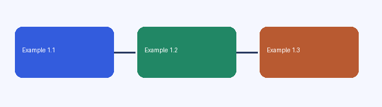

# HRS 合成使用示例



<div style="background-color:#554271;color:#fff"><p>记录示例</p><p><strong>先写下一句，再补充细节。</strong></p><p style="color:#e5ddf0">这是一份自造测试材料。</p></div>

## 段落与清单

普通段落包含说明[^a]，另一处说明[^b]。

- 普通项目
  - 子项目
- [x] 已完成项目
- [ ] 待完成项目

```markdown

```

## 表格与公式

| 参数 | 示例值 |
| --- | --- |
| A | 1 |
| B | 2 |

$$
\boldsymbol{x}+\alpha
$$

[^a]: 第一条自造脚注。
[^b]: 第二条自造脚注。
